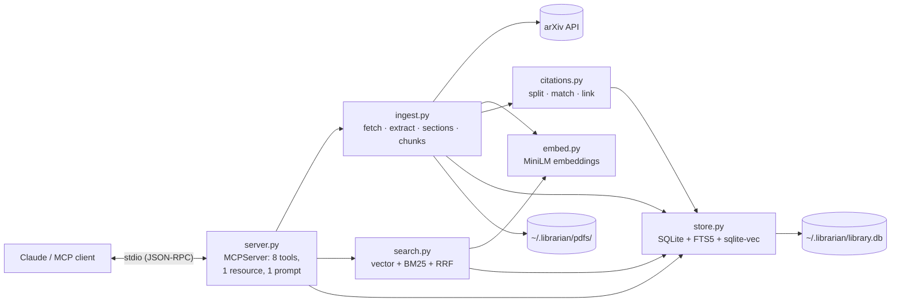
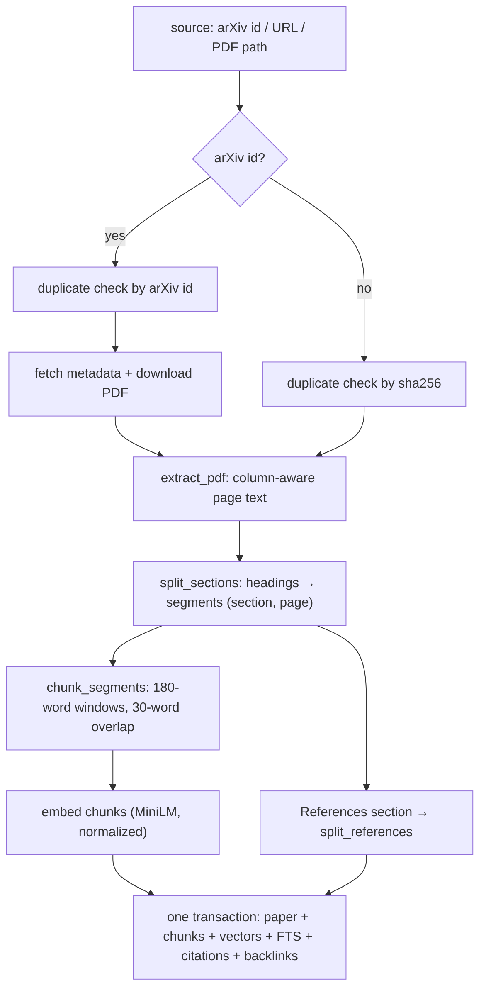
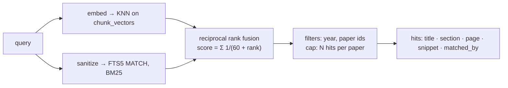

# Paper Librarian

An MCP server that gives Claude a local, searchable library of research papers (arXiv + PDFs).
Built on the **MCP Python SDK 2.x** (`MCPServer`, the 2.x successor to `FastMCP`).

Add papers by arXiv id or PDF path, then ask questions about them. Answers cite the paper, section
and page, and references between papers in the library are linked in both directions.

---

## Problem statement

Researchers and students keep dozens of papers as PDFs, but an AI assistant can't use them well:

- **No memory of your library.** Each chat starts from nothing; pasting whole PDFs runs into context
  limits and has to be repeated every time.
- **Answers from memory, not sources.** Without access to the actual text, a model summarizes papers
  from training data, which may be outdated, vague or wrong, and can't point to where a claim comes from.
- **PDFs are hard to read programmatically.** Two-column layouts, section headings, hyphenation,
  ligatures and reference lists in several citation styles all break naive text extraction.
- **Papers are connected, but the connections are invisible.** Which of my papers cite each other?
  That information is buried in reference lists.

**Paper Librarian** solves this with an MCP server that runs locally and:

1. ingests papers from arXiv or local PDFs into a structured library (sections, pages, references);
2. indexes them for **hybrid search** (meaning-based + keyword), returning passages with
   section and page so every answer can be cited;
3. parses reference lists and **links citations** between papers in the library;
4. exposes all of this to Claude (or any MCP client) as tools, a resource and a prompt.

Everything — database, PDFs, embedding model — stays on your machine.

---

## Features

- **Add papers** by arXiv id (`1706.03762`, `arXiv:1706.03762v5`), arXiv URL, or local PDF path, with
  duplicate detection by arXiv id and file hash.
- **Layout-aware PDF extraction**: two-column reading order, section detection using font weight and
  size, page tracking, ligature and hyphenation repair.
- **Hybrid search**: vector similarity (sqlite-vec) + BM25 keyword search (SQLite FTS5), merged with
  reciprocal rank fusion; filters by year and paper.
- **Citation graph**: reference lists split in `[n]`, `n.` and author-year styles; matched to library
  papers by arXiv id, exact title or fuzzy title; linked forwards and backwards as papers are added.
- **Section reader**: fetch the full text of any section ("Method", "Positional Encoding", …).
- **Comparison helper**: gathers the most relevant passages per paper per aspect for comparison tables.
- **Notes** attached to papers.
- **Local and private**: one SQLite file plus a PDF folder; no external services except arXiv
  downloads and the one-time model download.

---

## Tech stack

| Layer | Technology | Why |
|---|---|---|
| Language | Python 3.11+ (developed on 3.13) | Ecosystem for PDFs, ML and MCP |
| MCP server | [MCP Python SDK](https://github.com/modelcontextprotocol/python-sdk) **2.3** (`MCPServer`) | Tools, resources, prompts, progress reporting, stdio transport |
| PDF parsing | [PyMuPDF](https://pymupdf.readthedocs.io/) 2.0 | Fast text extraction with font, size and position data per span |
| arXiv | [`arxiv`](https://pypi.org/project/arxiv/) 4.0 + `requests` | Metadata lookup (title, authors, abstract) and PDF download |
| Embeddings | [sentence-transformers](https://www.sbert.net/) 6.2, model `all-MiniLM-L6-v2` (384-dim) | Small (~90 MB), CPU-friendly, good quality for retrieval |
| Vector index | [sqlite-vec](https://github.com/asg017/sqlite-vec) 0.1.9 (`vec0` table) | KNN search inside the same SQLite file |
| Keyword index | SQLite FTS5 (BM25 ranking) | Built into Python's `sqlite3`, no extra service |
| Storage | SQLite | Single file, transactional, zero setup |
| Testing | pytest 9, anyio, MCP in-process `Client` | Unit tests plus end-to-end tests through a real MCP client |
| Build | hatchling (`pyproject.toml`) | Standard packaging; `paper-librarian` console script |

---

## Architecture



### How a paper is added (`add_paper`)



### How a question is answered (`search`)



---

## Project structure

```
paper-librarian/
├── pyproject.toml            # dependencies, console script, pytest config
├── README.md
├── src/librarian/
│   ├── __init__.py           # package version
│   ├── server.py             # MCP server: tools, resource, prompt, lifespan        (333 lines)
│   ├── ingest.py             # arXiv fetch, PDF extraction, sections, chunking      (457 lines)
│   ├── search.py             # hybrid search, RRF, snippets                         (198 lines)
│   ├── citations.py          # reference splitting, matching, linking               (161 lines)
│   ├── store.py              # SQLite schema and data access                        (325 lines)
│   └── embed.py              # embedding model wrapper                              ( 53 lines)
└── tests/                    # 90 tests
    ├── test_server.py        # end-to-end through an in-process MCP client          (9)
    ├── test_ingest.py        # arXiv ids, headings, sections, chunking, ingestion   (39)
    ├── test_citations.py     # splitting styles, matching, linking                  (20)
    ├── test_search.py        # keyword / semantic / hybrid, filters, snippets       (10)
    ├── test_store.py         # schema, constraints, cascades                        (9)
    └── test_smoke.py         # dependencies load                                    (3)
```

---

## Code details

### `store.py` — data model and storage

All data lives in one SQLite file. The schema:

| Table | Columns | Notes |
|---|---|---|
| `papers` | `id`, `title`, `authors`, `year`, `abstract`, `source`, `arxiv_id`, `sha256`, `path`, `added_at` | `id` is `arxiv:<id>` or `pdf:<sha256[:16]>`; `arxiv_id` and `sha256` are `UNIQUE` (duplicate protection); `source` is `CHECK`ed to `arxiv`/`pdf` |
| `chunks` | `id`, `paper_id`, `seq`, `section`, `page`, `text` | Searchable passages; `UNIQUE(paper_id, seq)` |
| `chunks_fts` | FTS5 over `text`, `section` | External-content index kept in sync by `AFTER INSERT/DELETE` triggers |
| `chunk_vectors` | `vec0(chunk_id, embedding float[384])` | sqlite-vec KNN index; same id as `chunks.id` so results can be fused |
| `citations` | `id`, `paper_id`, `seq`, `raw_reference`, `matched_paper_id` | `matched_paper_id` → `papers.id`, `ON DELETE SET NULL` |
| `notes` | `id`, `paper_id`, `text`, `created_at` | |
| `meta` | `key`, `value` | Stores `embedding_dim`; reopening with a different model raises instead of corrupting the index |

Deleting a paper cascades to its chunks, FTS entries, vectors (via trigger), citations and notes.

`Store` provides typed access (`Paper`, `Chunk`, `Citation`, `Note` dataclasses):
`add_paper`, `get_paper`, `find_duplicate`, `list_papers`, `delete_paper`, `add_chunks` (with vectors),
`get_chunks(section=…)`, `add_citations`, `get_citations`, `get_cited_by`, `unmatched_citations`,
`set_citation_match`, `delete_citations`, `add_note`, `get_notes`.

`store.transaction(commit=True)` wraps writes; passing `commit=False` to individual methods lets a
caller group several writes into one atomic transaction (used by ingestion).

The connection is opened with `check_same_thread=False` because MCP tools run in worker threads; the
server serializes access with a lock.

### `ingest.py` — getting papers in

| Function | What it does |
|---|---|
| `parse_arxiv_id(source)` | Recognizes new-style (`2310.06825v2`), old-style (`hep-th/9901001`), `arXiv:` prefixes and `abs/`/`pdf/` URLs; returns the version-less id |
| `fetch_arxiv(id, pdf_dir)` | Metadata via the `arxiv` API, PDF via `requests` (arxiv 4.x dropped `download_pdf`); validates the `%PDF` header |
| `extract_pdf(path)` | Title (PDF metadata, else largest horizontal text on page 1), authors, year, section segments, raw References text |
| `page_text(page)` | **Column-aware reading order**: blocks are classified left / right / full-width around the page centre; within bands separated by full-width blocks, the left column is read before the right. Marks indented lines (for reference splitting) and emphasized lines (bold or ≥1.1× body font size, for heading detection). Merges spans on the same baseline and applies NFKC normalization (`fi` → `fi`) |
| `heading_name(line, appendix)` | Decides whether a line is a section heading. Known names (Introduction, Methods, …) map to canonical names; other numbered headings (`3 Model Architecture`) must be emphasized. Rejects years and decimals as section numbers, lines with column gaps, and sentence fragments. Letter numbering (`A`, `B.2`) only counts after References/Appendix |
| `split_sections(pages)` | Walks lines, producing `Segment(section, page, text, raw)`; a new segment starts on each page so page numbers stay accurate |
| `chunk_segments(...)` | 180-word windows with 30-word overlap, never crossing a section boundary. 180 words fits MiniLM's 256-token input limit, so nothing is silently truncated |
| `ingest(source, store, embedder, progress)` | The whole pipeline (diagram above); writes paper, chunks, vectors and citations in **one transaction**, so a failure never leaves half a paper |
| `rebuild_citations(store)` | Re-parses every stored PDF's references, e.g. after improving the parser |

### `embed.py` — embeddings

`Embedder` is a `Protocol` (`dim`, `embed(texts)`), so tests use small fake embedders.
`SentenceTransformerEmbedder` loads the model lazily (thread-safe), normalizes vectors, and offers
`warm_up()` to load in the background at server start so the first search doesn't wait.

### `search.py` — hybrid retrieval

| Function | What it does |
|---|---|
| `fts_query(text)` | Turns free text into a safe FTS5 query (each word quoted, OR-ed), so input like `"x"? AND NEAR*` can't cause syntax errors |
| `keyword_search(...)` | FTS5 `MATCH` ranked by BM25, joined to papers for filtering |
| `vector_search(...)` | sqlite-vec KNN; with filters it over-fetches (10×, min 200) and filters after, since `vec0` can't filter on paper columns during the scan |
| `rrf(rankings)` | Reciprocal rank fusion, `score = Σ 1/(60 + rank)`; records which methods found each chunk |
| `search(...)` | Runs one or both retrievers, fuses, applies a per-paper cap, and builds `SearchHit`s |
| `make_snippet(text, terms)` | Picks the window containing the most distinct meaningful query words (short words like "of" ignored) |

On a 4-paper, 10-query check (Transformer, BERT, ResNet, word2vec), hybrid search ranked the
correct paper first 10/10 times.

### `citations.py` — the citation graph

| Function / class | What it does |
|---|---|
| `split_references(raw)` | Tries `[n]` markers (≥2), then sequential `n.` markers (≥3, mostly counting up), then **hanging indents** for author-year styles (first line at the column edge, continuation lines indented). Rejoins words hyphenated across lines |
| `reference_arxiv_id(ref)` | Finds `arXiv:1607.06450`, `abs/1409.0473`, arxiv.org URLs |
| `Matcher` | Matches a reference to a library paper: **arXiv id** → **exact title** (compared as lowercase alphanumerics, so `Pre-\ntraining` = `Pretraining`) → **fuzzy title** (≥92% of title characters found in order, after a cheap word-overlap pre-filter). Titles under 12 characters ("BERT") never match on title alone; the longest matching title wins |
| `link_paper(store, paper, refs)` | Stores the paper's references matched against the library, **and** re-checks older papers' unmatched references against the new paper (backlinks). Self-citations are excluded. Re-running replaces the paper's previous citations |

### `server.py` — the MCP interface

`create_server(db_path=None, embedder=None)` builds an `MCPServer` whose **lifespan** opens the
`Store`, creates the embedder (warming it up), and yields an `AppState(store, embedder, lock)`.
Tools get it from `ctx.request_context.lifespan_context`. The factory lets tests inject a temporary
database and a fake embedder; `main()` runs the default server over stdio and quiets
model-hub HTTP logging (`httpx`, `httpx2`, `huggingface_hub`).

**Tools**

| Tool | Arguments | Returns | Annotations |
|---|---|---|---|
| `add_paper` | `source` | paper summary, `already_in_library`, chunk and reference counts; reports progress | open-world, idempotent |
| `search` | `query`, `limit=8` (max 30), `mode` (`hybrid`/`semantic`/`keyword`), `year_from`, `year_to`, `paper_ids` | `results[]`: paper id, title, year, section, page, snippet, matched_by | read-only |
| `get_paper` | `paper_id`, `section?` | metadata, abstract, sections (with start page), notes — or one section's full text (chunk overlaps removed, partial names accepted) | read-only |
| `get_citations` | `paper_id` | `references[]` with `in_library` link, `cited_by[]` | read-only |
| `compare_papers` | `paper_ids` (2–8), `aspects` (1–8), `passages_per_aspect=2` | passages per paper per aspect | read-only |
| `add_note` | `paper_id`, `text` | note id, timestamp | |
| `list_papers` | — | count, paper summaries | read-only |
| `remove_paper` | `paper_id` | removed id and title (PDF file kept) | destructive |

**Resource:** `library://papers` — the library as a Markdown list.
**Prompt:** `literature_review(topic)` — guides Claude through search → compare → citations → a cited review.

Paper ids are accepted in full (`arxiv:1706.03762`) or bare (`1706.03762`). Expected failures (unknown
paper, missing file, download error, unknown section) are raised as `ToolError`, so Claude gets an
actionable message such as *"No paper '…' in the library. Use list_papers to see paper ids."*

---

## Setup

```bash
cd paper-librarian
python -m venv .venv
.venv\Scripts\activate      # Windows  (source .venv/bin/activate on macOS/Linux)
pip install -e ".[dev]"
pytest -q                   # 90 tests
```

The first run downloads the `all-MiniLM-L6-v2` embedding model (~90 MB).

## Connect to Claude

**Claude Code**

```bash
claude mcp add paper-librarian --scope user -- <path-to-repo>/.venv/Scripts/python.exe -m librarian.server
claude mcp get paper-librarian   # should show: Status: ✔ Connected
```

Start a new Claude Code session afterwards; servers are loaded when a session starts.
Remove with `claude mcp remove paper-librarian -s user`.

**Claude Desktop** — add to `claude_desktop_config.json` (Settings → Developer → Edit Config), then restart:

```json
{
  "mcpServers": {
    "paper-librarian": {
      "command": "C:/path/to/paper-librarian/.venv/Scripts/python.exe",
      "args": ["-m", "librarian.server"]
    }
  }
}
```

## Try it

- "Add arXiv 1706.03762 and 1810.04805 to my paper library"
- "What do my papers say about positional encoding? Cite sections."
- "Compare BERT and the Transformer on pre-training corpus, model size and results"
- "Which papers in my library cite Attention Is All You Need?"
- Use the `literature_review` prompt with a topic

## Configuration

| Variable | Default | Meaning |
|---|---|---|
| `LIBRARIAN_HOME` | `~/.librarian` | Library folder (`library.db`, downloaded `pdfs/`) |
| `LIBRARIAN_EMBED_MODEL` | `sentence-transformers/all-MiniLM-L6-v2` | Embedding model (must produce 384-dim vectors) |
| `HF_HUB_OFFLINE` | unset | Set to `1` once the model is downloaded to skip Hugging Face checks at startup |

## Testing and debugging

```bash
pytest -q                                   # unit + end-to-end MCP tests
npx @modelcontextprotocol/inspector .venv/Scripts/python.exe -m librarian.server
```

`tests/test_server.py` connects the SDK's `Client` to the server in-process and exercises every
tool, the resource and the prompt, including progress notifications and error cases.

---

## Known limitations

- **Scanned PDFs** (no text layer) are rejected; there is no OCR.
- **Unusual layouts**: three-column pages, or reference lists that fit none of the three styles,
  may extract or split imperfectly.
- **Subsections replace parent names**: text under 3.2.1 is labelled `Scaled Dot-Product Attention`,
  not `Model Architecture`.
- **Filtered semantic search** over-fetches and filters afterwards; with many thousands of papers, a
  very narrow filter could miss results.
- **Ingestion holds the database lock**, so other tool calls wait while a paper is being added
  (typically 5–30 s).
- **Hyphen rejoining** also merges genuine compounds broken at a line end (`sequence-aligned` →
  `sequencealigned`).
- References to papers **outside** the library are stored as text only (no Semantic Scholar lookup yet).

## Roadmap

- Semantic Scholar lookup for references not in the library
- OCR fallback for scanned PDFs
- Parent/child section hierarchy
- Packaging for `uvx paper-librarian`
